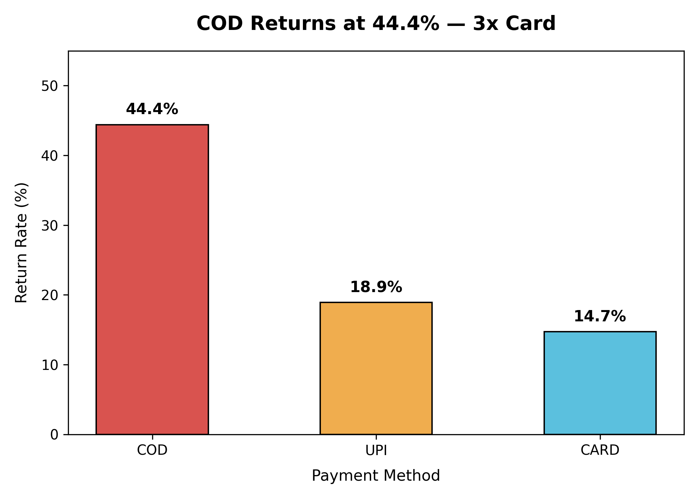
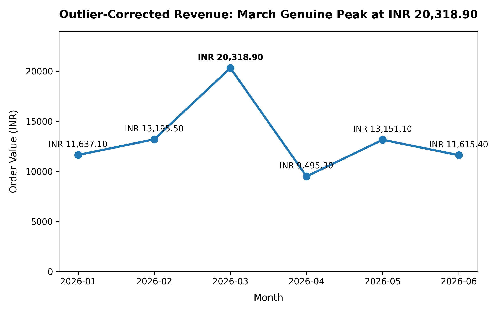

# Mamaearth_Returns_Growth_Intelligence_Pipeline
End-to-end data pipeline combining relational SQL analytics, Python data cleaning &amp; EDA, automated visualizations, and an executive SCR business narrative powered by Gemini API with an offline fallback.

# Mamaearth Returns & Growth Intelligence Pipeline

An end-to-end analytics pipeline on Mamaearth-style e-commerce order data: **SQL** for relational analysis, **Python** for cleaning and EDA, **matplotlib** for visuals, and a **Gemini-powered executive narrative** (Situation → Complication → Resolution) with an offline fallback so it always runs.

## Business Problem

Regional ops and finance heads need to know two things:

1. **Where are returns coming from, and what's driving them?**
2. **Can we trust the revenue numbers?** Duplicate submissions and bulk-order outliers can distort both totals and monthly trends.

## Key Findings

| # | Finding | Evidence |
|---|---------|----------|
| 1 | **Revenue was overstated by ₹2,501.90** | Raw total ₹99,860.20 vs cleaned ₹97,358.30. The entire gap comes from 5 double-submitted orders. |
| 2 | **COD returns at ~3x the rate of Card** | COD 44.4% · UPI 18.9% · Card 14.7% |
| 3 | **Return risk is concentrated in Tier-2 COD** | COD + Tier-2 cities: **54.5%** (22 orders) vs COD + Tier-1: 37.5% (32 orders) |
| 4 | **January's "peak" is an artifact** | Two bulk orders inflated Jan to ₹29,582.10. Corrected, it is ₹11,637.10 and **March (₹20,318.90) is the true peak**. |
| 5 | **Discounts don't reduce returns** | Correlations between rating, returned, discount_pct and quantity are all negligible (\|r\| < 0.2). |

### Visuals




## Recommendations

- **Target Tier-2 COD orders first** with address/phone pre-verification and prepaid-payment incentives.
- **Plan inventory and campaigns around March**, not January.
- **Add duplicate-order protection at checkout** to prevent repeat overstatement.

## Pipeline Overview

```
data/*.csv ─► sql/ (MySQL analysis)
          └─► analysis/clean_and_eda.py ─► findings ─► analysis/visualization.py ─► visualizations/*.png
                                                  └──► narrator/generate_narrative.py ─► SCR narrative
```

### 1. SQL Analytics (`sql/`)
- `schema.sql`: three-table relational model (`customers`, `products`, `orders`) with primary and foreign keys.
- `seed_data.sql`: loads the dataset.
- `reports.sql`: business queries covering revenue and AOV (with `COALESCE` for null discounts), `COUNT(*)` vs `COUNT(column)`, `LEFT JOIN` vs `NOT IN` cross-validation to find customers with zero orders, city-level return rates with `GROUP BY … HAVING`, top-customer ranking with `LIMIT/OFFSET`, category revenue via a three-table join, `LIKE` and `DISTINCT`, and `ALTER TABLE` + `UPDATE … CASE` to add a loyalty tier.

### 2. Cleaning & EDA (`analysis/clean_and_eda.py`)
- Standardised `payment_method` (7 messy raw variants → `CARD` / `UPI` / `COD`).
- Removed 5 duplicate orders, defined as identical on every column except `order_id`.
- Imputed missing values: `discount_pct` → 0 (no promotion), `rating` → median.
- Reconciled the cleaned total against the SQL raw total.
- Flagged quantity outliers using the IQR method (kept, not dropped, so corrected and uncorrected trends can be compared).
- Tested the COD hypothesis, ran multi-level segmentation (payment × city tier), built a correlation matrix, and produced an outlier-corrected monthly revenue series.

### 3. Visualizations (`analysis/visualization.py`)
Generates the two charts above at 300 dpi into `visualizations/`.

### 4. AI Narrative (`narrator/`)
- `findings.json`: the verified numbers from the EDA step.
- `generate_narrative.py`: produces a ~250-word SCR executive summary.
  - **With `GEMINI_API_KEY` set**: uses the Gemini API, with a system prompt that restricts the model to the supplied figures (no invented statistics).
  - **Without a key, or on API error**: falls back to a deterministic offline template that interpolates every number from `findings.json`.
- `sample_output.txt`: example output.

## Dataset

Synthetic Mamaearth-style data, January–June 2026:

| File | Rows | Description |
|------|------|-------------|
| `customers.csv` | 45 | City, city tier, signup date, acquisition source |
| `products.csv` | 16 | Haircare, Skincare, Babycare, PersonalCare |
| `orders.csv` | 180 raw (175 after dedup) | Quantity, discount, payment method, rating, returned flag |

> The dataset is small and synthetic, so treat the findings as a demonstration of method rather than statistically conclusive results.

## Tech Stack

MySQL · Python (pandas, matplotlib) · Google Gemini API (`google-genai`)

## How to Run

```bash
# Install dependencies
pip install pandas matplotlib google-genai

# SQL: run in MySQL, in this order
#   sql/schema.sql → sql/seed_data.sql → sql/reports.sql

# Cleaning & EDA (reads the CSVs from the current directory)
cd data && python ../analysis/clean_and_eda.py && cd ..

# Charts (run from the repo root)
python analysis/visualization.py

# Narrative: offline template
python narrator/generate_narrative.py

# Narrative: with Gemini
export GEMINI_API_KEY="your-key"
python narrator/generate_narrative.py --save-sample
```

## Project Structure

```
├── analysis/
│   ├── clean_and_eda.py
│   └── visualization.py
├── data/
│   ├── customers.csv
│   ├── orders.csv
│   └── products.csv
├── narrator/
│   ├── findings.json
│   ├── generate_narrative.py
│   └── sample_output.txt
├── sql/
│   ├── schema.sql
│   ├── seed_data.sql
│   └── reports.sql
└── visualizations/
    ├── return_rate_by_payment.png
    └── monthly_revenue_trend.png
```

## Skills Demonstrated

SQL (joins, aggregation, window-free ranking, DDL/DML) · data cleaning and deduplication · outlier detection (IQR) · hypothesis testing and segmentation · correlation analysis · data visualization · reconciling numbers across tools · LLM integration with a reliable offline fallback

## Author

**Deepak Rajput**: [GitHub](https://github.com/deepakrajput2622a-dotcom)
